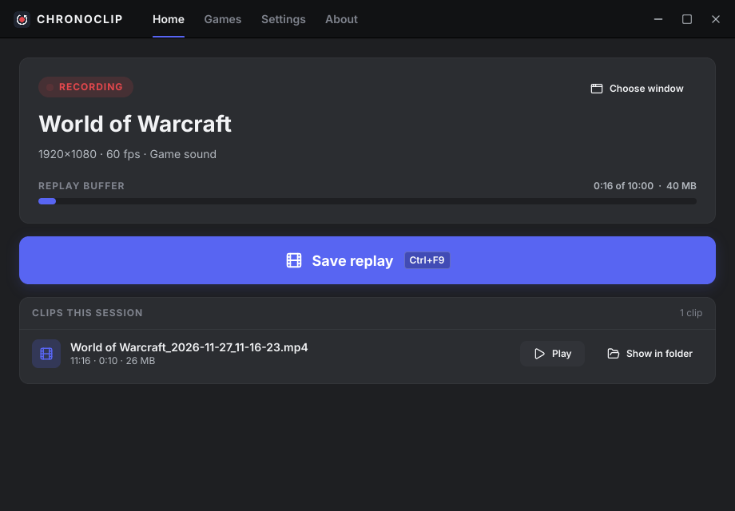
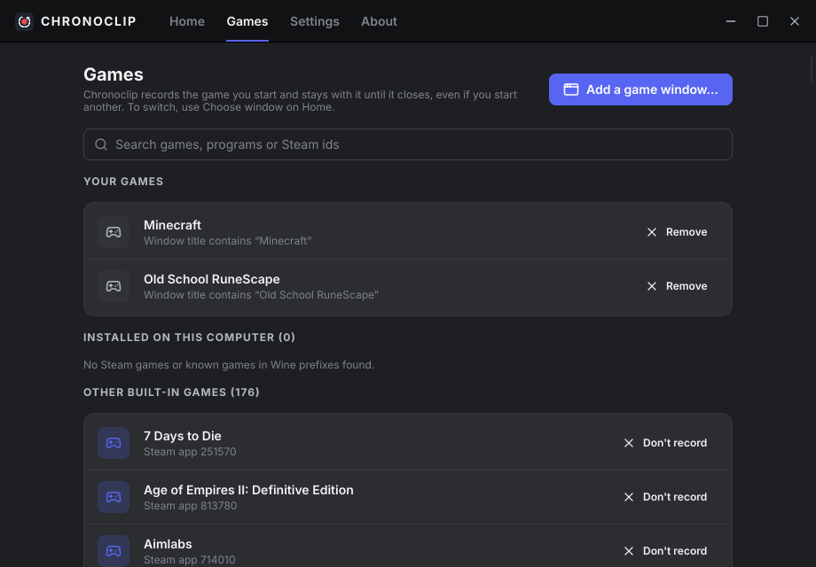
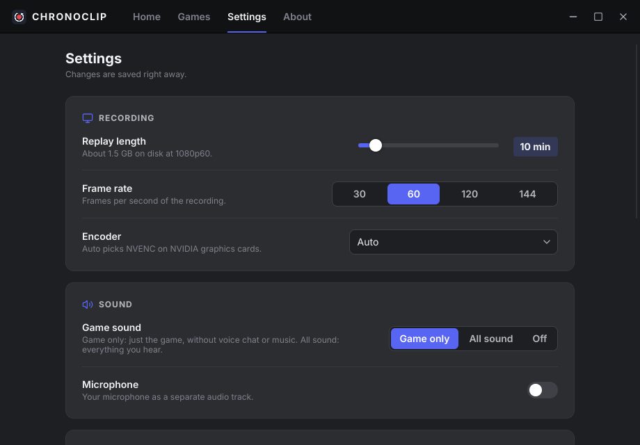

# Chronoclip

> An open source, lightweight **replay buffer for your games on Linux**. Think NVIDIA ShadowPlay "Instant Replay", but native to Linux and vendor-neutral. Made for World of Warcraft first, and it records any game: Steam and Proton, Battle.net, Lutris, Heroic or native Linux games.

Chronoclip continuously records your gameplay to a rolling buffer on disk. When something worth keeping happens (a boss kill, a clutch round, a hilarious wipe) press your hotkey (default **`Ctrl+F9`**) and the last *N* minutes are saved as a normal video file.

> **Status:** 🧪 Beta. Recording any game and saving replays with sound work and are used daily on X11 with an NVIDIA GPU. Wayland and AMD/Intel GPUs are next. See [Roadmap](#roadmap).

<p align="center">
  
  
</p>
<p align="center">
  
</p>

## What it is

Chronoclip is a **replay buffer**, like a dashcam for your game. You never have to remember to press "record" before the good part happens:

1. **It is always recording.** While a game runs, Chronoclip records its window in the background and keeps the last *N* minutes (5 to 45, default 10) on disk. Anything older is deleted automatically, so the buffer never grows.
2. **You decide afterwards what to keep.** Something great just happened? Press `Ctrl+F9`. The last *N* minutes are saved as an MP4 in `~/Videos/Chronoclip/<game>`, ready to watch, trim or share on Discord.
3. **Everything else is thrown away.** No hours of footage to sort through, no full disk. When you start a game again (or another one), the previous recording is dropped, so a clip never mixes two game sessions.

### Using it

- Start Chronoclip once; it sits in the system tray. Closing the window keeps it recording in the background.
- Start a game as usual (Steam, Faugus, Lutris, Heroic, …). Chronoclip finds it by itself and starts recording: your installed Steam games, games in Wine prefixes it knows (Battle.net games, for example) and 176 built-in games are recognized. For anything else it asks *"Record this game?"*, or you pick the window with **Choose window**. The tray tooltip and the window show the status.
- It stays with the game you started, even if you start another one; **Choose window** switches.
- Press the hotkey (or click **Save replay** in the window or tray menu, or run `chronoclip save`). A few seconds later the clip is in your clips folder.

### What it costs

Recording uses the GPU's video encoder (NVENC), so the game barely notices. Frames stay on the GPU from capture to encoder.

| | Measured at 2560×1368 @ 60 fps, RTX 4080 |
|---|---|
| CPU | about 2 % of one core, plus about 1 % with sound |
| GPU / video encoder | about 8 % / 9 % |
| Disk | about 1.5 GB per 10 minutes of buffer at 1080p60, 7 GB for 45 minutes at 1440p |
| Saving | 1 to 2 s for a short clip, 6 s for a full 45 minute buffer (no re-encoding) |

### Safe for your account

Chronoclip only reads what your desktop already shows on screen and plays through your speakers, through the X server's official compositing API (and later the Wayland screen-sharing portal) and the sound server's recording API. It **never** injects into, hooks, or reads the memory of the game process, and it sends nothing over the network.

## Why

Windows players have ShadowPlay, ReLive, Medal and friends. On Linux the options are either general-purpose (OBS) or CLI-first. Chronoclip is a small, focused, native desktop app for one job: *always be recording your game, save the good bits with one key*. It is built by a Linux WoW player for their own use and shared in case it is useful to others.

## Features

Works today (X11 + NVIDIA):

- **Always-on replay buffer** on disk, oldest footage deleted automatically, cleaned up on exit.
- **Save on hotkey**: a configurable global hotkey (default `Ctrl+F9`) that works while the game has focus, plus a Save button, tray menu and `chronoclip save` CLI command.
- **Game sound**: only the game's own audio by default, so voice chat and music stay out of your clips; or *all sound* if you want your Discord call in them. Optional **microphone** on its own track.
- **Configurable buffer length**: from **5 to 45 minutes** (default **10**).
- **Instant saves**: saving joins the already-encoded segments into an MP4 without re-encoding, so it takes seconds, not minutes.
- **Hardware encoding** with NVENC, GPU-only capture path.
- **Finds your games by itself**: installed Steam games, Blizzard and other known games in Wine prefixes (Faugus, Lutris, Heroic, Bottles, Steam), 176 built-in games, and games you add. Proper names from Steam, Heroic, Lutris and Faugus.
- **Asks about unknown games**: a window that looks like a game but is in no list gets *"Record this game?"* (on Home and in a notification), with *Record* or *Not this one*.
- **Games tab**: your games, the ones installed on this computer, the ones you switched off and the built-in list, with search; **Choose window** picks any window.
- **A folder per game**: `~/Videos/Chronoclip/ELDEN RING/ELDEN RING_2026-11-27_21-04-33.mp4`.
- **Modern dark window** in the style of the Battle.net launcher and Discord: big status, the replay buffer filling up, a big **Save replay** button with your hotkey, the clips you saved this session (the last 10, each with **Play** / **Show in folder**), settings in cards, a hotkey recorder (click and press your keys).
- **Fully native and lightweight**: Rust all the way down, native UI with [Slint](https://slint.dev). No Electron, no webview.
- **Tray app** that keeps recording when the window is closed. The icon shows the state: red while recording, grey while waiting for a game, amber on errors.
- **You hear when a clip is saved**: a short chime (a different tone if saving failed), also while playing, plus a desktop notification with **Play** and **Show in folder**.
- **Start with the desktop** (optional): starts in the tray when you log in.
- **Packages**: a .deb for Ubuntu and Linux Mint and an AppImage for other distros, on [GitHub Releases](https://github.com/etse/chronoclip/releases/latest); both bring their own FFmpeg.

Planned (see [Roadmap](#roadmap)):

- **Wayland** (screen capture and hotkey through portals) and **AMD / Intel** GPUs (VAAPI).

## Tech stack

| Layer | Choice |
|---|---|
| Language | Rust (single Cargo workspace, no Node / JS toolchain) |
| UI | Slint (native, software renderer: crisp text, no OpenGL in the UI) with our own dark components, the Inter typeface and Lucide icons |
| Video capture | XComposite → OpenGL texture (X11, GPU-only path), xdg-desktop-portal ScreenCast + PipeWire (Wayland) |
| Audio capture | PipeWire (through its PulseAudio API, per-application capture), AAC |
| Encoding / muxing | FFmpeg (libav*, LGPL, dynamically linked): NVENC (via CUDA), VAAPI |
| Global hotkey | GlobalShortcuts portal (Wayland), X11 key grab, fallback `chronoclip save` CLI |
| Tray | Slint `SystemTrayIcon` (StatusNotifierItem) |

The reasoning is recorded in [docs/adr/](docs/adr/). The design is in [docs/architecture.md](docs/architecture.md).

## How it works (short version)

```
 Game window ─► XComposite / PipeWire ──► NVENC / VAAPI ──► 2 s segments in ~/.cache
 Game audio ──► PipeWire ──────────────┘                     (rolling, oldest deleted)
                                                                    │
            Ctrl+F9 / `chronoclip save` ──► take last N min ────────┘
                                              └──► remux (no re-encode) ──► ~/Videos/Chronoclip/<game>/*.mp4
```

## Requirements

| | |
|---|---|
| Display server | X11 (primary) or Wayland |
| Global hotkey on Wayland | A compositor with the GlobalShortcuts portal: KDE Plasma 6, GNOME 48+, Hyprland. Otherwise bind `chronoclip save` in your desktop's keyboard settings |
| Screen capture on Wayland | xdg-desktop-portal with a backend for your desktop (one-time permission prompt) |
| Audio | PipeWire |
| GPU | Any with VAAPI (AMD / Intel) or NVENC (NVIDIA) |
| Tray icon | StatusNotifierItem support (KDE yes; GNOME needs the AppIndicator extension) |

### Reference setup

Chronoclip is developed and tested first on the maintainer's machine. Other setups should work but are best-effort until someone tests them.

| | |
|---|---|
| Distro | Linux Mint 22 (Cinnamon, X11), Ubuntu 24.04 base |
| GPU | NVIDIA, proprietary driver |
| WoW | Retail, DirectX 12 (vkd3d-proton), launched with [Faugus Launcher](https://github.com/Faugus/faugus-launcher) (UMU / Proton) |
| Display mode | Borderless windowed ("Windowed (Fullscreen)") |

## Installation

Download the latest release from **[GitHub Releases](https://github.com/etse/chronoclip/releases/latest)**:

- **Ubuntu 22.04+ / Linux Mint 21+:** `chronoclip_<version>_amd64.deb`, then double-click it or `sudo apt install ./chronoclip_*_amd64.deb`.
- **Other distros** (glibc 2.35+): `Chronoclip-<version>-x86_64.AppImage`, then `chmod +x` and run it.

You need an X11 session and an NVIDIA GPU with the proprietary driver (530+). **[INSTALL.md](INSTALL.md)** has the details, and what developers need to build it.

## Getting started (development)

Install the developer dependencies from [INSTALL.md](INSTALL.md#developers-building-from-source), then:

```sh
cargo run -p chronoclip            # run the app (shows the window of a running instance if there is one)
cargo run -p chronoclip -- save    # save | show | quit, sent to the running instance
cargo test --workspace             # run tests
```

Settings are stored in `~/.config/chronoclip/settings.toml`.

## Saving a replay

Any of these saves the last *N* minutes (your buffer length) while recording keeps going:

- press the hotkey (default **`Ctrl+F9`**), also while the game has focus,
- click **Save replay** in the window, or **Save replay** in the tray menu,
- run `chronoclip save`. It waits for the clip and prints its path, so you can also bind it to a key in your desktop's keyboard settings (the way to go on Wayland until the portal hotkey lands).

A short rising chime tells you the clip was saved, and a lower falling tone that it wasn't (for example when nothing was recorded yet). A desktop notification shows the clip's length and size, with **Play** and **Show in folder** buttons. Cinnamon hides notifications over fullscreen windows by default (borderless games count), so in-game the chime is what you notice; the notification is waiting when you alt-tab. With *All sound*, the chime is recorded at the start of the next clip.

Clips go to a folder per game, e.g. `~/Videos/Chronoclip/World of Warcraft/World of Warcraft_YYYY-MM-DD_HH-MM-SS.mp4` (H.264 + AAC in MP4, plays everywhere, starts instantly in browsers and Discord). The save waits up to two seconds for the moment you pressed the key to be written, then copies the video without re-encoding, so even long clips take seconds. If the game window changed size during the buffer, the clip starts at the resize. Each save starts where the previous clip ended, so two clips never contain the same footage.

## Configuration

Games are managed on the **Games** tab: remove one you added, switch off one that isn't a game (*Don't record*), or add a window with *Add a game window…*. Everything else is on the **Settings** tab and saved automatically: buttons and switches at once, the slider when you let go, folder fields when you press Enter or leave the field. To change the hotkey, click it and press the new key combination (Esc cancels).

| Setting | Default | Range / notes |
|---|---|---|
| Save hotkey | `Ctrl+F9` | Ctrl / Alt / Shift / Super + F1–F24, A–Z or 0–9 (bare F-keys allowed); set by pressing it. Shown in red if another program already uses it |
| Buffer length | 10 min | 5 to 45 min |
| Buffer location | `~/.cache/chronoclip/buffer` | Must be on disk (SSD), **not** a RAM-backed tmpfs like `/tmp` or `$XDG_RUNTIME_DIR` on many distros |
| Output folder | `~/Videos/Chronoclip` (XDG videos dir) | |
| Resolution / FPS | Native / 60 | 30, 60, 120, 144 |
| Encoder | Auto (best available) | VAAPI, NVENC, software fallback |
| Quality | Auto | Constant quality or constant bitrate |
| Sound | Game only | *Game only* (the game's own audio; all sound until it is found), *All sound* (everything you hear, incl. voice chat and music), *Off* |
| Microphone | Off | Your default microphone as a second audio track (players and Discord play only the first track) |
| Play a sound when a clip is saved | On | Chime on success, lower tone on failure |
| Chronoclip title bar | On | Off: your desktop's normal window title bar instead of Chronoclip's own |
| Start in the tray when you log in | Off | Writes `~/.config/autostart/chronoclip.desktop` (not stored in `settings.toml`; the switch shows whether that file exists) |

**Disk usage tip:** at 1080p60 and ~20 Mbit/s, a 10 minute buffer uses about 1.5 GB. A 45 minute buffer at the same bitrate uses about 6.8 GB.

## Roadmap

Detailed status and task checklists: [docs/roadmap.md](docs/roadmap.md).

1. **M0, scaffold** ✅ repo, docs, agent instructions
2. **M1, skeleton app** ✅ Slint window, tray icon, settings persisted to disk, single instance + `chronoclip save` IPC
3. **M2, capture pipeline (X11 + NVIDIA)** ✅ XComposite window capture → GL texture → CUDA → NVENC → rolling segments
4. **M3, save replay** ✅ X11 global hotkey → lossless remux of the last N minutes to MP4
5. **M4, audio** ✅ game audio via PipeWire (game only or all sound), optional mic track
6. **M5, polish** ✅ save notification and chime, tray state, start with desktop
7. **M6, packaging** ✅ .deb (Ubuntu/Mint) and AppImage on GitHub Releases (v0.1.0)
8. **M7, modern dark UI** ✅ Battle.net-style tabs, Discord-like look (blurple accent), custom title bar, hotkey recorder, last clip card
9. **M8, other games** ✅ record any game, not just WoW: installed and 176 built-in games found by themselves, "Record this game?" for unknown ones, window picker, a clip folder per game, this session's clips on Home (v0.3.0, first beta)
10. **M9, Wayland + AMD/Intel**: portal/PipeWire capture, GlobalShortcuts portal, VAAPI

## Non-goals

- **Windows / macOS support.** Great tools already exist there.
- Streaming, editing, or uploading clips.

## Prior art

- [gpu-screen-recorder](https://git.dec05eba.com/gpu-screen-recorder/about/): excellent Linux GPU recorder with a replay mode. Worth studying.
- [OBS Studio](https://obsproject.com) replay buffer.

## Contributing

Contributions are welcome. See [CONTRIBUTING.md](CONTRIBUTING.md). The repository is set up for AI coding agents too (Claude Code, opencode, and others); see [AGENTS.md](AGENTS.md).

## License

[MIT](LICENSE). FFmpeg is used under the LGPL via dynamic linking. The UI uses [Slint](https://slint.dev) under its Royalty-free Desktop License (attribution shown in the About page).

## Disclaimer

Chronoclip is a fan-made project and is not affiliated with or endorsed by Blizzard Entertainment, Valve or any other game publisher. World of Warcraft is a trademark of Blizzard Entertainment, Inc. Other game names belong to their owners.
